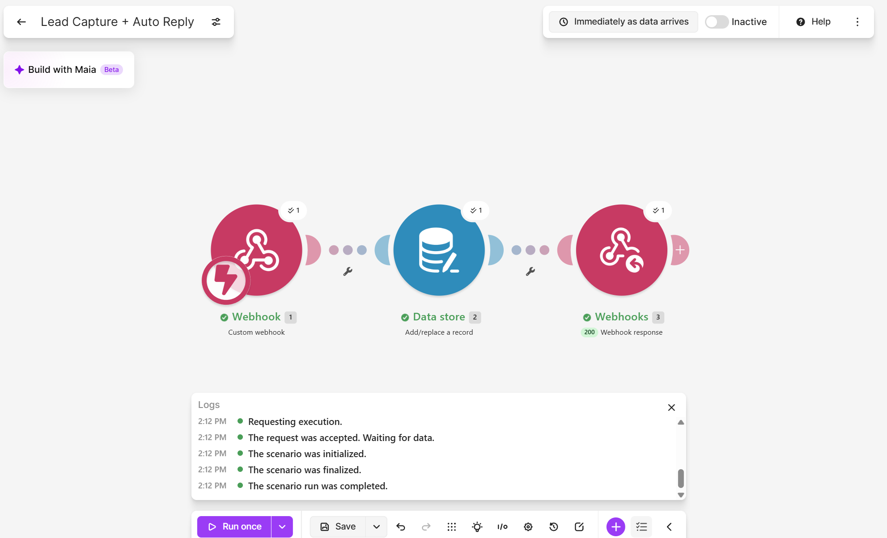
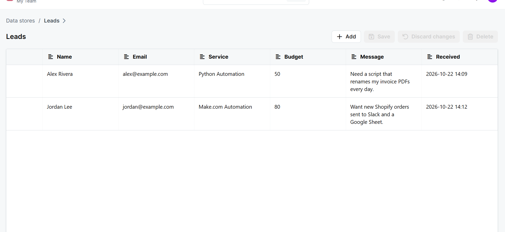

# Lead Capture + Auto Reply (Make.com)

A no-code automation built in **Make.com**. It catches new leads from any website form, saves them to a database, and replies right away with a personal message.

**Never lose a lead. Reply in under 1 second, 24/7.**



## How it works

| Step | Module | What it does |
|------|--------|--------------|
| 1 | **Webhook** (Custom webhook) | Receives the lead from a website form, landing page, or app: name, email, service, budget, message |
| 2 | **Data store** (Add/replace a record) | Saves the lead with a timestamp in a `Leads` database |
| 3 | **Webhook response** (200) | Sends back an instant, personalized reply |

## Example

**Lead sent in:**
```json
{"name": "Jordan Lee", "email": "jordan@example.com", "service": "Make.com Automation", "budget": "80", "message": "Want new Shopify orders sent to Slack and a Google Sheet."}
```

**Instant reply:**
```json
{"ok": true, "reply": "Thanks Jordan Lee! Got your Make.com Automation request. I will get back to you within 24 hours."}
```

**Saved leads:**



## Easy to extend
- Send the lead to **Google Sheets**, **Airtable**, or a CRM (HubSpot, Notion)
- Get a **Slack / Discord / email alert** for every new lead
- Add **ChatGPT** to write a custom reply based on the lead's message
- Filter by budget and send high-value leads first

## Tools
Make.com · Webhooks · Data stores · JSON

---
Need something like this for your business? Contact me for custom Make.com, Zapier, and Python automations.
